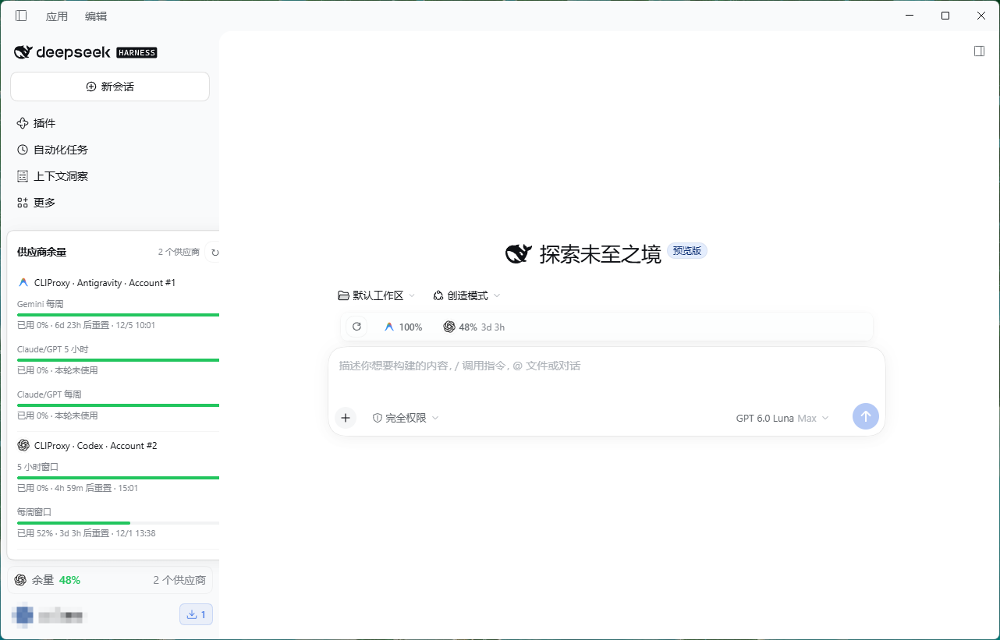
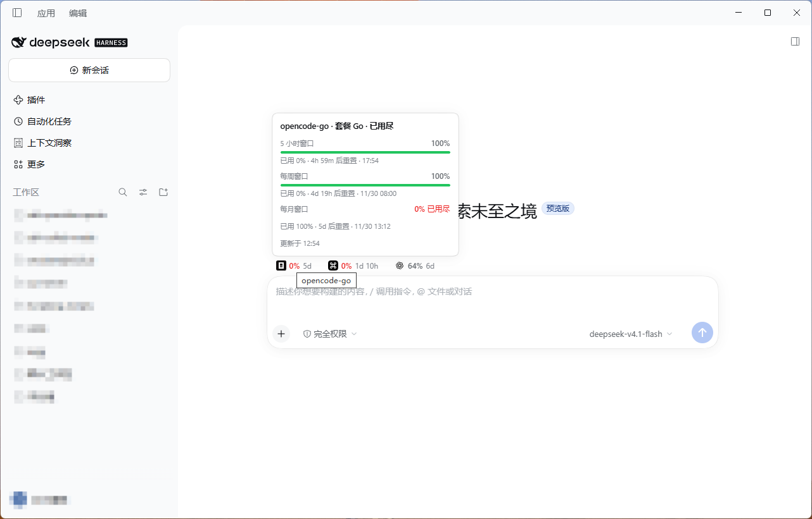

# 供应商余量

DeepSeekRuntime（DSH）插件：在对话框上方常驻一行，把已配置供应商的套餐余量压成一排徽标——每个徽标是官方图标 + 最吃紧窗口的剩余比例 + 重置倒计时，鼠标悬停展开全部窗口的明细。





## 功能

- **一行看完**：每个供应商一个徽标，例如 `[OpenAI 图标] 64% 6d 1h`——剩余比例取该供应商最吃紧的那个窗口，后面是它的重置倒计时。
- **悬停即明细**：弹出卡片列出 5 小时 / 每周 / 每月窗口，或按模型、按模型池分组的窗口；每行给剩余比例、进度条、已用比例、重置倒计时与具体时刻。
- **点一下刷新**：点击这一行立即重读，各供应商受自己的刷新下限保护，不会被供应商限流。
- **只显示读得到的**：只出现本机确实能查到余量的供应商——有内置适配器的，以及本机登录了 Codex、Claude Code、Gemini CLI 或正在运行 Antigravity 的。
- **跟随主题与语言**：颜色取自 DSH 设计变量，中英文案内置，深浅主题都跟随。
- **不占位**：一个能查到余量的供应商都没有时，整行不渲染。

## 支持的供应商

| 供应商 | 余量来自 | 窗口 |
|---|---|---|
| `opencode-go` | API Key `OPENCODE_GO_API_KEY` | 5 小时 / 每周 / 每月 |
| `command-code`（注册表 id `commandcode` 也认） | 上游插件在宿主注册的 `commandcodeUsage` 服务；未安装时用 API Key `COMMANDCODE_API_KEY`（旧名 `COMMAND_CODE_API_KEY` 兼容） | 5 小时 / 每周 / 每月 |
| Codex（本地 CLI） | `~/.codex/auth.json` 里 Codex CLI 自己的 ChatGPT 登录态 | 5 小时 / 每周 |
| Claude Code（本地 CLI） | `~/.claude/.credentials.json` 里的 OAuth 登录态 | 5 小时 / 每周 / Sonnet、Opus 每周 / 每月 |
| Gemini CLI（本地 CLI） | `~/.gemini/oauth_creds.json` 里的 OAuth 授权 | 按模型族：Gemini Pro / Flash / Flash Lite |
| Antigravity（本地服务） | 本机 `language_server` 或 `agy` 进程的 loopback RPC | Gemini 池、Claude/GPT 池，各 5 小时 + 每周 |

自建中转站这类没有可查余量接口的供应商不会出现。

### Command Code：优先读上游插件的共享服务

装了 [Mars-Sea/dsh-commandcode-provider](https://github.com/Mars-Sea/dsh-commandcode-provider) 时，本插件优先读它在宿主注册的 `commandcodeUsage.report()`——和它自己的设置页、`/commandcode` 面板同一个数据源，账号与密钥解析都由它负责，本插件不再重复打账单接口：

- **一个徽标**：多账号时只显示正在服务的那个账号（`active && configured`），没有 active 就取第一个已配置账号；`provider` 仍是 `command-code`，图标也照旧。
- **窗口只算真能算的**：5 小时 / 每周只在 `cap > 0` 时按 `used / cap` 换算；`cap` 为 0 或没带 cap 是**不限量**，既不当成耗尽、也不画成 0%。月窗只在 `monthlyReported !== false` 且套餐月额度（`plan.monthlyCredits`）大于 0 时，用剩余 `monthlyCredits` 与额度换算。
- **读不到就说读不到**：选中账号没有额度块、或它的账单端点全部失败时，徽标显示「读取失败」，不会悄悄消失；只有确认是「不限量、本来就没有可算的比例」时才不出徽标。
- **回退**：没装那个插件、或它的服务没有应答时，回退到本插件自己的直连（`/alpha/billing/credits` + `/alpha/billing/subscriptions`），密钥解析规则见下。
- **两个 id、两个密钥名**：`commandcode` 与 `command-code` 都认，同时出现也只出一个徽标；密钥先查 `COMMANDCODE_API_KEY`（那个插件存的就是这个），再退回旧名 `COMMAND_CODE_API_KEY`，两个都设时以新名为准。

本插件只认这两个环境变量名，不读那个插件的配置；若你在那边把 `apiKeyEnv` 改成了别的名字，把同一把密钥再以 `COMMANDCODE_API_KEY` 存一次（或在启动环境里导出）即可——装了那个插件时通常用不到：它的服务已经把密钥解析好了。

## 界面

紧凑态（直接从第一家供应商开始，行首不带标题文字或图标）：

```
[opencode 官方图标] 0% 5d 1h   [command-code 官方图标] 0% 1d 11h   [OpenAI 官方图标] 64% 6d 1h   [Claude 官方图标] 67% 4h 12m   [Antigravity 官方图标] 79% 5d 2h
```

- 徽标用**供应商官方站点的图标**（`opencode.ai`、`commandcode.ai`、`openai.com`、`claude.ai`、`gemini.google.com`、`antigravity.google`），32px PNG 以 data URL 内联，不额外发请求、不受 CSP 影响；没有登记图标的供应商回退成两个字母的首字母徽标。
- 百分数是**剩余**比例，后面的 `5d 1h` 是它的重置倒计时。剩余 ≤20% 转警示色，≤0 标红。
- 整行就是目标条那张卡，样式照抄运行中版本（`@deepseek-ai/dsh-client-ui-goal` 的 `.bar`）：圆角 `--dsw-radius-md`（12px）、高 `36px`、内边距 `4px 6px`；**没有 border**，那圈 0.5px 描边和投影都由 `box-shadow: var(--dsw-elevation-panel)` 画出来（描边色取自 `--dsw-elevation-stroke-color: var(--dsw-alias-border-l1)`）；底色是菜单表面 `--dsw-specific-menu`（浅色 `rgba(252,253,254,.7)`），铺在内容下面一层并带 `backdrop-filter: var(--dsw-menu-backdrop-filter)`（`blur(40px) saturate(150%)`）。宽度按同一套算法居中——`min(容器宽度 − 2 × --dsh-composer-side-clearance − 4 × --dsh-composer-dock-inset, --dsh-composer-card-max-width − 4 × --dsh-composer-dock-inset)`，即左右各比输入卡片缩进 16px；徽标自带 6px 内边距，所以第一个徽标距卡边 12px，和目标条图标的位置一致。唯一的差别是高度用 `min-height` 而不是固定值，窄窗口下徽标换行时卡片长高，而不是被裁掉。
- 卡片底色是必需的，不是装饰：这一行浮在对话流上方，消息正文会从卡片下滚过，没有底色时文字会透过徽标之间的空隙，把百分比和倒计时冲得看不清。
- 徽标展开（悬停或键盘聚焦）时**不给整块底色**，只在徽标下方画一道底边平直、顶边圆弧的短弧（SVG 曲线），与卡片底边对齐、和供应商信息留开距离；弧线从下方向上移动并渐显，收起时向下渐隐。颜色为较淡的 `--dsw-alias-interactive-bg-hover`，同时把该格文字提亮到 `--dsw-alias-label-primary`。
- 整行的无障碍名是「余量」；徽标可键盘聚焦，聚焦即展开卡片，鼠标离开整行即收起。

悬停卡片（示例）：

```
opencode-go · 套餐 Go
5 小时窗口                        100%
[━━━━━━━━━━━━━━━]
已用 0% · 4h 59m 后重置 · 17:54
每周窗口                          100%
[━━━━━━━━━━━━━━━]
已用 0% · 4d 19h 后重置 · 11/30 08:00
每月窗口                            0% 已用尽
[]
已用 100% · 5d 后重置 · 11/30 13:12
更新于 12:54
```

- 标题是「供应商 · 套餐」，任一窗口用尽时追加「已用尽」。
- 进度条填充的是**剩余**比例；没有重置时间时那行显示「本轮未使用」或「无重置时间」。
- 按模型、按模型池分组的窗口直接用名字当标题，例如 Claude 的 `Sonnet` / `Opus` 每周窗口（账号没有对应模型时接口返回 `null`，那一行不出现）、Gemini 的 `Gemini Pro` / `Gemini Flash` / `Gemini Flash Lite`、Antigravity 的 `Gemini 5 小时` / `Claude/GPT 每周`。
- 卡片底部的「更新于」是该供应商这次数据的读取时刻。

首次加载、手动刷新或读取重试时，额度条暂时显示「读取中…」提示和旋转指示；手动刷新会请求刷新接口（各供应商仍受自身刷新下限保护）。读取失败时关闭加载提示，显示「读取失败」（点击可重试）。刷新完成后恢复额度内容；单个供应商读不到时，徽标位置换成「未配置密钥」「需要重新登录」「该账号不可用」之一，鼠标悬停可看原因。

## 数据来源

宿主半边注册一条同源 JSON 路由 `GET /provider-quota/state`，浏览器半边只渲染它——密钥、登录 token 和所有对供应商的请求都留在宿主半边。

- **供应商列表**来自运行时 LLM 注册表，取其中有内置适配器的 id；新增、删除供应商会自动反映。`commandcode` 归到 `command-code` 适配器，`anthropic`、`claude-code`、`gemini-cli`、`google-gemini` 这类 id 归到对应适配器。
- **本地 CLI / 本地服务**不在注册表里，单独作为常驻来源：`codex`、`claude`、`gemini` 各读自己的登录文件，并认自己的目录变量（`CODEX_HOME` / `CLAUDE_CONFIG_DIR` / `GEMINI_CLI_HOME`），**登录文件不存在就整条不出现**；`antigravity` 以进程在不在为准，没在跑就不出现。登录、启动之后再轮询一次就自己冒出来。
- **Command Code 共享服务**（装了上游插件时）：`commandcodeUsage.report()` 由上游宿主半边提供，本插件只取 `active && configured` 那个账号的 `report.credits` / `report.plan` 换算窗口；服务不存在或抛错才走下面的直连接口。
- **API Key** 通过凭据 seam 按环境变量名解析，改密钥后下一轮轮询就生效；解析失败时回退到进程环境变量，再失败则显示「未配置密钥」。一个供应商有多个环境变量名时按优先级依次尝试（`command-code`：`COMMANDCODE_API_KEY` → `COMMAND_CODE_API_KEY`）。
- **用量接口**：

| 供应商 | 接口 | 映射 |
|---|---|---|
| `opencode-go` | `GET https://opencode.ai/zen/go/v1/usage` | `usage.rolling` → 5 小时、`weekly`、`monthly`；`percent` 是**已用**比例，`resetsAt` 是 ISO 时间 |
| `command-code`（共享服务） | 上游插件注册的 `commandcodeUsage.report()`（`ctx.inject(['commandcodeUsage'])`） | `accounts[].report`：取 `active && configured` 账号；`credits.fiveHour` / `.weekly` 的 `used` / `cap` / `resetAt`（epoch 毫秒）→ 5 小时 / 每周，**只在 `cap > 0` 时**换算；`credits.monthlyCredits` 与 `plan.monthlyCredits` → 每月（`monthlyReported === false` 时不出月窗） |
| `command-code`（回退直连） | `GET https://api.commandcode.ai/alpha/billing/credits` | `windowLimits.fiveHour` / `.weekly` 的 `used` `cap` `resetAt`（epoch 毫秒） |
| `command-code`（回退直连 · 每月） | `GET https://api.commandcode.ai/alpha/billing/subscriptions` | `data.planId` + `data.currentPeriodEnd`，配合套餐月度额度（GOAT=70、Pro=30…）换算月窗 |
| `codex`（本地 CLI） | `GET https://chatgpt.com/backend-api/codex/usage` | `plan_type`（PLUS / PRO…）+ `rate_limit.primary_window` → 5 小时、`secondary_window` → 每周；`used_percent`、`reset_at`（秒） |
| `claude`（本地 CLI） | `GET https://api.anthropic.com/api/oauth/usage` | `five_hour` → 5 小时、`seven_day` → 每周、`seven_day_sonnet` / `seven_day_opus` → 按模型的每周窗口、`extra_usage` → 每月；`utilization` 是**已用**比例，`resets_at` 是 ISO 时间 |
| `gemini`（本地 CLI） | `POST …/v1internal:loadCodeAssist` + `POST …/v1internal:retrieveUserQuota` | `loadCodeAssist` 给套餐和 `cloudaicompanionProject`（查询必须带 project，拿不到时退回 Cloud Resource Manager 里 `gen-lang-client*` 或带 `generative-language` 标签的项目）；`buckets[]` 的 `modelId` 归到 Pro / Flash / Flash Lite 三组，`remainingFraction` 换算成已用，`resetTime` 是 ISO 时间 |
| `antigravity`（本地服务） | `POST https://127.0.0.1:<port>/exa.language_server_pb.LanguageServerService/RetrieveUserQuotaSummary`（先 `GetUnleashData` 探活，失败退 `GetUserStatus` → `GetCommandModelConfigs`） | `response.groups[]` 里 `Gemini Models` / `Claude and GPT models` 两组，每组 `buckets[]` 的 `window`（`5h` / `weekly`）→ 4 个窗口；`remainingFraction` 换算成已用，`resetTime` 支持 ISO 或 epoch 秒 |

本插件只访问上表这些供应商自己的余量接口，不向别处发送数据；图标是内联的 data URL，也不联网。

Claude、Gemini、Antigravity 三条的接口形状照公开项目的做法实现：
[Claude Code Usage Monitor 的 OAuth usage 说明](https://github.com/Maciek-roboblog/Claude-Code-Usage-Monitor/issues/202)、
[codexbar 的 claude / gemini / antigravity 数据源文档](https://github.com/bcharleson/codexbar/blob/main/docs/gemini.md)、
[codexbar 的 Antigravity 探针源码](https://github.com/bcharleson/codexbar/blob/main/Sources/CodexBarCore/Providers/Antigravity/AntigravityStatusProbe.swift)、
[gemini-cli 的 `retrieveUserQuota`](https://github.com/google-gemini/gemini-cli/blob/main/packages/core/src/code_assist/server.ts)。

## Claude / Gemini / Antigravity 的前提

- **Claude** 用的是 Claude Code 自己的 OAuth 登录（要有 `user:profile` scope）。所以用 API Key、Bedrock、Vertex 跑 Claude Code 的话没有这个登录态，也就没有订阅余量可查，这条不会出现。token 过期时本插件**不会**替你刷新（刷新会让 Claude Code 自己的授权失效），只显示「需要重新登录」，跑一次 `claude` 就恢复了。
- **Gemini** 走 Gemini CLI 的 OAuth。个人 Google 账号的 Gemini CLI 额度已不再提供（2026-06 起），这类账号显示「该账号不可用」，卡片里写明原因；企业 / Code Assist Standard 账号照常。个人账号请看 `antigravity` 那一条。
- **Antigravity** 没有公网接口，额度只在本地 `language_server`（Antigravity 应用 / IDE）或 `agy` CLI 的 loopback RPC 上，所以它跑着的时候才会出现：
  - **找进程**：Windows 用 `Get-CimInstance Win32_Process`，其它平台用 `ps -ax`；匹配 `language_server` + antigravity 标记（app / ide），或 `agy` / `antigravity-cli`（CLI）。同类里取**启动时间最新**的那个——旧进程可能还挂着更早登录的账号。
  - **拿端口**：Windows `netstat -ano -p tcp`，其它平台 `lsof -nP -iTCP -sTCP:LISTEN`。每个端口先试 HTTPS（自签证书）再试 HTTP，最多 6 个端点。
  - **认证头**：桌面端（app / ide）必须带进程命令行里的 `--csrf_token`，拿不到就换下一个进程；`agy` 的 CLI 服务不需要 token，但它新版本会拒绝无 token 请求，这种情况显示读取失败。
  - **取数**：`RetrieveUserQuotaSummary { forceRefresh: true }` 给两个池各 5 小时 + 每周共 4 个窗口；老版本只给 `GetUserStatus` 的 `clientModelConfigs[]`（只有 5 小时窗口），再退 `GetCommandModelConfigs`。
  - 只**复用**已经在跑的 `agy`，不会替你冷启动它。

## 刷新与缓存

- 默认 60 秒轮询一次。宿主侧另有缓存，多个标签页不会重复打供应商接口：默认 45 秒，Claude 5 分钟（`api/oauth/usage` 限流较紧），Gemini 2 分钟，Antigravity 45 秒；Command Code 走上游共享服务时也只保留一次 `report()` 的结果 45 秒。
- 点击这一行 → 立即重读，但受刷新下限约束：Claude / Gemini 最快 60 秒一次，Antigravity 30 秒，Command Code 共享服务 30 秒，其余无下限。
- 读取失败时保留上一次数字；从未成功过则显示「读取失败」。
- 徽标是否出现只看「登录文件在不在」或「Antigravity 进程在不在」（判断结果缓存 2 分钟；Antigravity 的进程扫描在找到时缓存 30 秒、没找到时 5 分钟），所以登录、登出、启动、退出之后最多一轮就能反映，空闲时基本不产生开销。

## 安装

```sh
dsh plugin --profile web add github:bmqy/dsh-provider-quota

# 想钉住版本就用提交号（GitHub 源码安装会执行安装期脚本，钉住更稳）
dsh plugin --profile web add github:bmqy/dsh-provider-quota#<commit-sha>
```

装完重启 DSH。从 GitHub 源码安装时 pnpm 会拦下安装期构建脚本，`dsh` 会打印出要加进配置档 `pnpm-workspace.yaml` 里 `allowBuilds` 的键，照提示加一次、重试即可（本插件自身没有构建步骤）。

重启后在「设置 → 模型」里配好供应商的密钥，或在本机登录 Codex / Claude Code / Gemini CLI、启动 Antigravity，对应徽标就会出现在输入框上方。

## 许可证

[MIT](LICENSE) © bmqy
